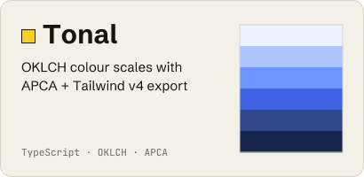
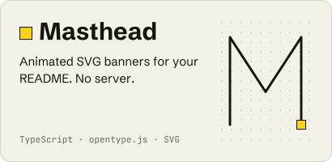
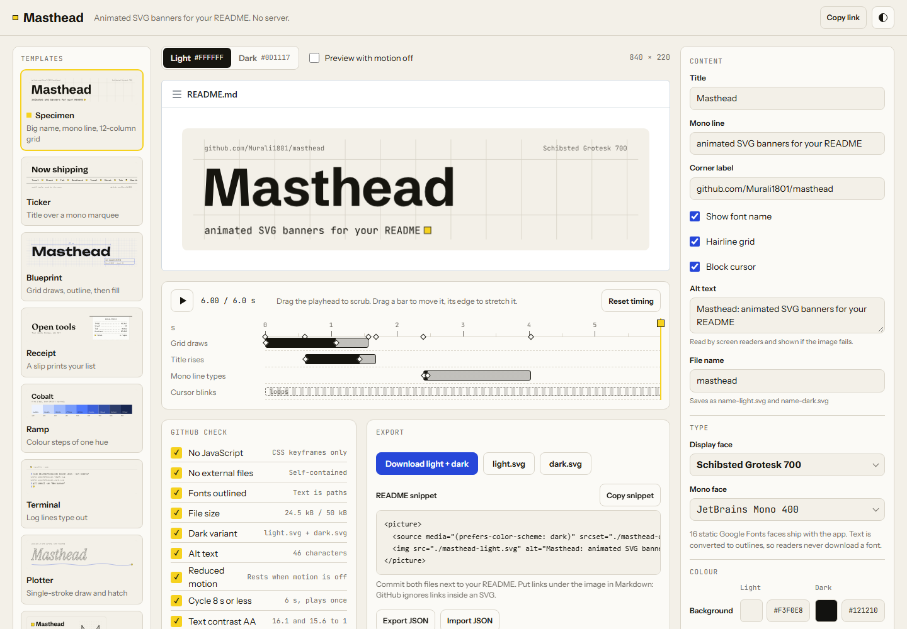

<picture>
  <source media="(prefers-color-scheme: dark)" srcset="./examples/murali/masthead-murali-dark.svg">
  
</picture>

<table>
  <tr>
    <td>
      <picture>
        <source media="(prefers-color-scheme: dark)" srcset="./examples/murali/card-tonal-dark.svg">
        
      </picture>
    </td>
    <td>
      <picture>
        <source media="(prefers-color-scheme: dark)" srcset="./examples/murali/card-masthead-dark.svg">
        
      </picture>
    </td>
  </tr>
</table>

<picture>
  <source media="(prefers-color-scheme: dark)" srcset="./docs/screenshot-dark.png">
  
</picture>

# Masthead

Design animated SVG banners for your GitHub README. No server, real fonts, light and dark files you own.

**Live editor:** https://masthead.vercel.app (TODO: not deployed yet)

## Quick start

```bash
git clone https://github.com/Murali1801/masthead
cd masthead
npm install
npm run dev
```

Pick a template, edit the text, scrub the timeline, then press **Download light + dark** and **Copy snippet**. Commit both SVGs next to your README and paste:

```html
<picture>
  <source media="(prefers-color-scheme: dark)" srcset="./banner-dark.svg">
  
</picture>
```

Render the same design from the command line or CI:

```bash
node bin/masthead.mjs examples/banner.json --out assets/
```

The CLI needs Node 22.18 or newer. `examples/workflow/masthead.yml` is a GitHub Actions workflow that re-renders your banners whenever a config changes.

## Features

- **Eight templates**, each a live thumbnail: Specimen, Ticker, Blueprint, Receipt, Ramp, Terminal, Plotter and a 410 by 200 Project card with four small looping illustrations.
- **True README preview** at the 840 px design width, on GitHub's own light `#FFFFFF` and dark `#0D1117`.
- **Timeline scrubber.** The playhead drives the paused CSS animation through a negative `animation-delay`. Drag a bar to move a track, drag its edge to stretch it, double-click or press Delete to reset. Keyframe markers sit on the ruler.
- **GitHub check**, live: no JavaScript, no external files, fonts outlined, size against 50 kB, dark variant, alt text, reduced-motion rule, cycle of 8 s or less, text contrast.
- **Fonts as outlines.** 16 static faces from 12 Google Fonts families ship in `public/fonts` (OFL, see `LICENSES.md`). opentype.js turns your text into `<path>` data, so readers never load a font and nothing is hotlinked.
- **Light and dark pairs** for every colour, exported as two files for `<picture>`.
- **Play once or loop.** Play once builds in and rests. Cursors blink on their own 1 s clock with `steps(1)`.
- **Yours to keep.** Export and import the config as JSON. The whole design also lives in the URL hash, so a link is a backup.
- Every SVG carries `@media (prefers-reduced-motion: reduce)` and rests in its final state when motion is off.

## Why not a hosted renderer?

Star counts read from the GitHub API on 2026-11-15.

| | Masthead | [capsule-render](https://github.com/kyechan99/capsule-render) (1,856 stars) | [readme-typing-svg](https://github.com/DenverCoder1/readme-typing-svg) (9,523 stars) | [github-readme-stats](https://github.com/anuraghazra/github-readme-stats) (79,840 stars) |
|---|---|---|---|---|
| Where it renders | Your browser or your CI | Public Vercel instance | PHP server | Public Vercel instance |
| Files you commit | Yes, two SVGs | No, hotlinked URL | No, hotlinked URL | No, hotlinked URL |
| Fonts | 16 curated faces, outlined | Server fonts | Google Fonts via server | Fixed |
| Dark mode | Separate dark file | Via parameters | Via parameters | Themes |
| Visual timeline | Yes | No | No | No |
| Strength | Typographic banners and cards | 15 banner shapes, quick | The typing effect, one URL | Live GitHub stats |

Hosted renderers are great when you want live data or a one-line URL. Masthead is for a designed banner that keeps working when someone else's quota runs out.

## How it works

1. `src/core` is pure TypeScript with no DOM. A template lays out text with opentype.js metrics and returns SVG markup. Motion is declared as tracks: a start and length inside one cycle plus keyframes.
2. `src/core/motion.ts` turns every track into `@keyframes` over the full cycle, so staggered tracks loop together. Resting states are the elements' own styles, which is why the reduced-motion rule can simply switch animations off.
3. In the editor the same renderer adds `animation-play-state: paused` and `animation-delay: calc(<delay> - var(--t))`. Moving the playhead only sets `--t`.
4. Glyph outlines are written as compact relative path data, rounded once in absolute space so long outlines never drift. Output is deterministic: the same config gives the same bytes.
5. `bin/masthead.mjs` imports the same core (Node runs the TypeScript directly) and loads the fonts from `public/fonts`.

```
src/core      renderer, templates, checks, config (shared by app and CLI)
src/app       the editor UI
src/node      font loading for Node
bin           CLI
examples      configs, rendered profile files, Actions workflow
tests         Vitest
```

## Contributing

Issues and pull requests are welcome. Good first contributions:

- A new template in `src/core/templates/` (add it to `index.ts`; the tests pick it up).
- A new card illustration in `card.ts`.
- Another OFL font: add it to `scripts/fetch-fonts.mjs` and `src/core/fonts.ts`, run `npm run fonts`.

Run `npm test` and `npm run build` before you open a PR. Generated SVGs must pass the GitHub check.

## Licence

MIT, see [LICENSE](./LICENSE). Fonts are under the SIL Open Font License 1.1, see [public/fonts/LICENSES.md](./public/fonts/LICENSES.md).

---

Part of a set of tools by Murali: Tonal · Sheet · Tab · Masthead
